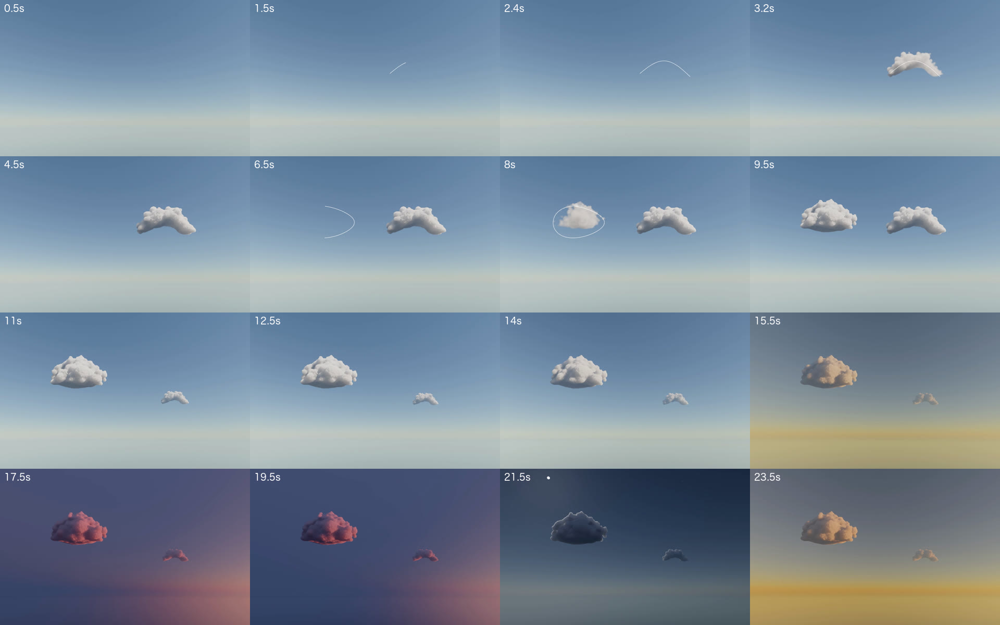
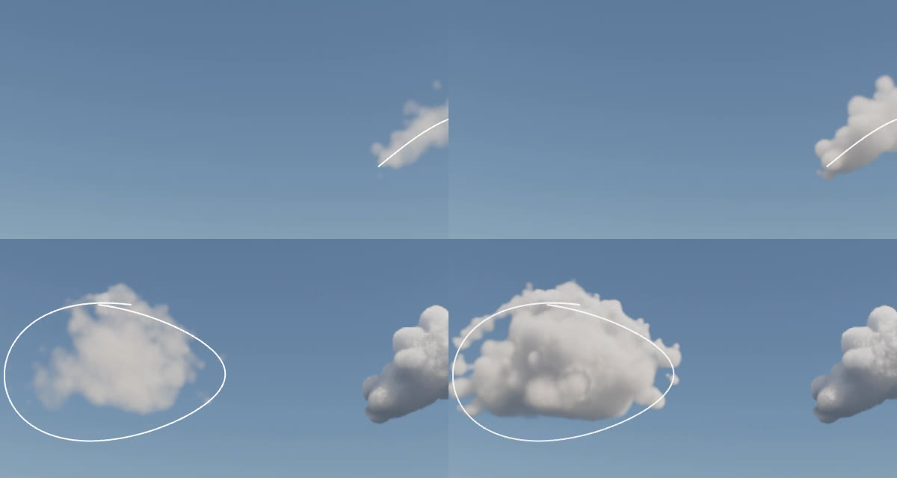
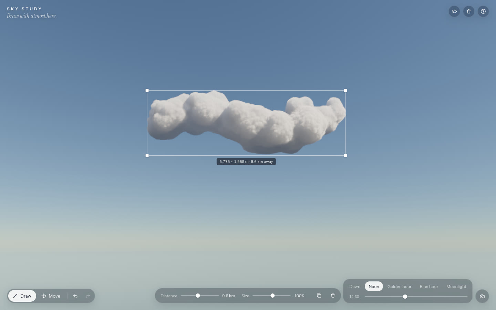
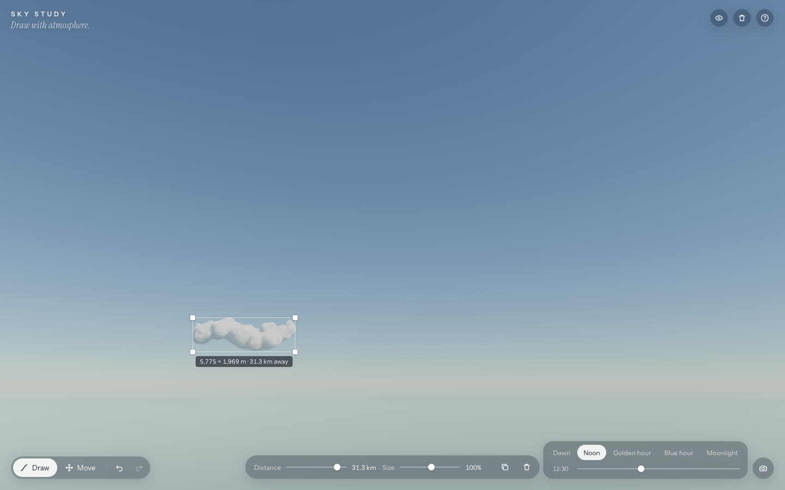
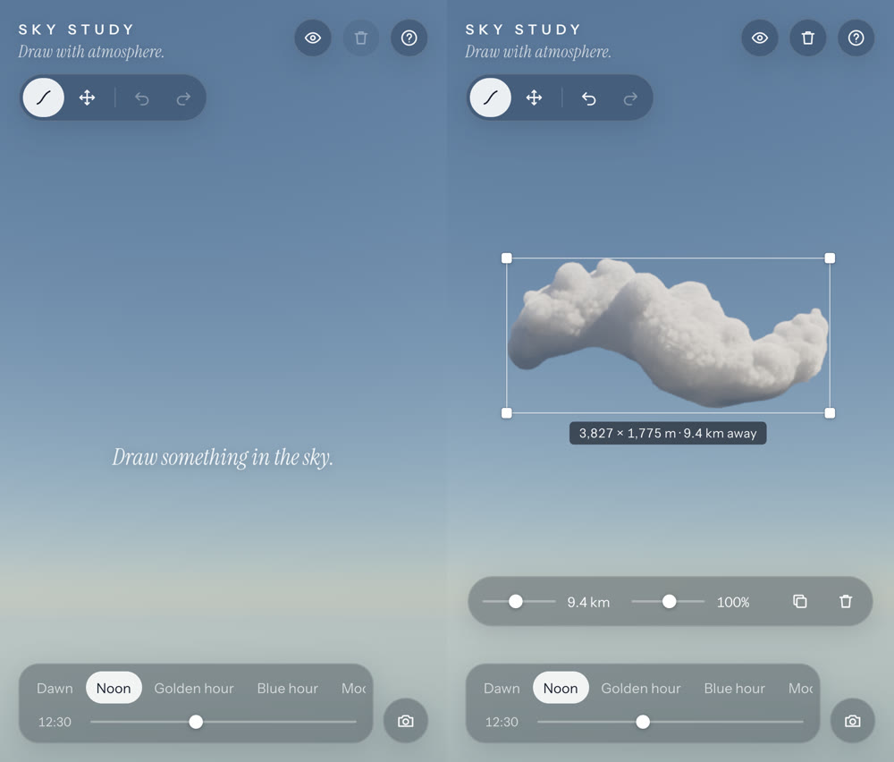

# SKY STUDY — a design-engineering case study



## Concept

Clouds are the one thing everyone has tried to draw with a finger in the air. The idea here is to let that gesture land: you draw a line, and the sky answers with a cloud that has weight, depth and light. That only works if the cloud looks like vapour lit by the sun, not a white sticker, so most of the effort went into the renderer. The interface stays almost invisible.

The starting point was a short clip by @azlenelza on X (five screenshots supplied). From those frames you can see a thin white line and crosshair, very realistic cumulus forms, bright tops over blue-grey undersides, grainy early frames that later turn smooth, and a selection box labelled in metres. Nothing about how it was built is public, so none of this project claims to reproduce that technique. Everything here was built from scratch on published rendering methods (see [ATTRIBUTION.md](ATTRIBUTION.md)), and it adds three things the clip doesn't show: clouds you can move through real 3D space, depth with true perspective, and a lighting model that runs through the whole day.

## Interaction: from pointer samples to a volume

1. **Capture.** Pointer events (including coalesced ones) are stored in CSS pixels and drawn as a smoothed 2 px SVG path.
2. **Project.** On release, every sample is cast as a camera ray onto a vertical drawing plane 9 km away. The stroke becomes a 2D path in kilometres. A 300 px gesture makes a cloud about 3 km across, which matches the scale labels in the reference.
3. **Clean up.** Invalid samples are dropped, the path is resampled by arc length, smoothed (keeping its endpoints) and centred. Strokes under 250 m are rejected with a message instead of failing silently.
4. **Classify.** A stroke whose ends nearly meet, and whose length is well over its size, counts as *closed*.
5. **Lobes.** An *open* stroke puts primary lobes every half-radius along the path. The radius grows with stroke length and tapers at the ends, and extra lobes in front and behind give the cloud depth. A *closed* stroke is filled: points inside are sampled, and each lobe's radius comes from its distance to the outline (similar to "inflation" in sketch-based modelling), so the silhouette follows the drawing. After that, both kinds get convective towers on their highest lobes and smaller cauliflower lobes on upper surfaces.
6. **Flat base.** The bottom of the mass is cut off with a smooth band, because real cumulus has a flat condensation level. That's also why a heart turns into a flat-bottomed cloud rather than a heart-shaped object.
7. **Bake.** The lobes are combined into a 96×64×64 coverage volume (`1 − Π(1 − kᵢ)` over smooth kernels). A second channel stores the order in which each region forms.

Everything is seeded. A cloud is saved as *stroke + seed + transform*, and its geometry is rebuilt from that, so reloading or duplicating a cloud never re-rolls it. Unit tests check that identical inputs give byte-identical volumes, and that wave, vertical, loop and heart gestures produce the expected proportions.

## Graphics: one raymarch for the whole sky

Rendering uses raw WebGL2 (no scene graph) and three passes:

- **Sky-view LUT (256×144).** Rayleigh, Mie and ozone single scattering along each view direction, plus a ground term below the horizon. It is only recomputed when the light changes.
- **Scene.** One fullscreen raymarch at a reduced internal resolution covers every cloud. Each cloud's 3D texture slot sits in a shared atlas of 16. The ray is transformed into each cloud's space and clipped to its box, then the clouds it crosses are sorted by entry distance and marched front to back. Overlapping clouds are integrated in the same march, so a nearer cloud correctly hides a farther one without any sorting artefacts.
- **Accumulate + present.** Jittered frames are averaged while nothing moves, then tone-mapped with AgX and dithered.

**Density.** The baked coverage behaves like a smooth distance field, and noise octaves push its surface in and out:

```
d = coverage + bias − (1 − perlinWorley)·0.30 − (1 − billows)·0.32   // 600 m … 150 m
d −= (1 − cauliflower)·(0.30 … 0.42)                                 // 110 m … 27 m, wispier at the base
density = smoothstep(0, ~0.1, d)
```

The noise is tileable Perlin-Worley and inverted Worley ("billows"), generated on the GPU at startup into 128³ and 32³ 3D textures. The narrow `smoothstep` at the end is what turns soft blobs into crisp cauliflower. My first version eroded only a soft fringe, and it looked like cotton.

**Formation.** Instead of a fade, the shader uses a `reveal` value per voxel (from global growth and the baked formation order). It raises the coverage, strips away the noise displacement, and weakens the fine erosion while the edge ramp is still wide. The cloud starts as translucent vapour along the gesture and tightens into billows over 3.4 s, while the line holds and then fades.



## Lighting: the sky and the clouds share one model

One number, the **hour**, drives everything. Art-directed keyframes set the sun's azimuth and elevation, haze and an exposure bias. From those, a CPU copy of the same atmosphere code computes:

- the **key light** at cloud altitude: solar illuminance × transmittance through the atmosphere. This is where golden-hour amber comes from; it isn't a tint. After sunset the clouds stay lit slightly past the horizon dip, and the deep red is softened toward pink.
- **ambient skylight**: an irradiance-weighted average of the sky over the hemisphere, from the same scattering code.
- **ground bounce** for cloud bases.
- **exposure**: partial auto-exposure (`∝ L^-0.78`), so night still reads darker than day.

Single scattering goes black once the sun is about 6° below the horizon. The real sky stays lit by light scattered from high altitude, so I added a **twilight term** (a blue dome plus a warm glow toward the sun's azimuth) to the GPU sky and the CPU ambient alike. That gave blue hour its lavender. At night the moon takes over as key light, and a scotopic shift in the tonemapper makes it bluer and less saturated.

In the cloud shader, each lit sample uses a 6-step jittered light march, four multiple-scattering octaves (Wrenninge et al.) with a dual-lobe Henyey-Greenstein phase, a restrained "powder" term for dark crevices, skylight that is brighter on tops and occluded by the mass above, energy-conserving integration (Hillaire), and aerial perspective that mixes distant clouds into the sky colour behind them.

The tests check lighting through rendered pixels, not preset names. On the same cloud, the highlight warmth (r/b of the brightest 10%) must rise by more than 15% from noon to golden hour, and moonlight must be darker and bluer.

| Noon | Golden hour | Blue hour | Moonlight |
| --- | --- | --- | --- |
|  |  |  |  |

## Spatial manipulation

The camera is fixed: 1 km up, pitched 15°, 50° vertical FOV, units in kilometres. Clouds have real world positions, and their apparent size comes only from projection.

- **Picking** ray-tests the gesture lobes (shrunk 18% for the erosion) rather than the noisy density, so hits are stable and forgiving. The nearest hit wins.
- **Dragging** moves the cloud across a camera-facing plane through its centre and keeps the grab offset. The E2E test checks there's no jump at the start of a drag.
- **Depth** (scroll, ⇧-drag or slider) keeps the cloud's altitude and bearing. My first version slid clouds along the view ray, which sent a cloud pushed to 30 km up to 10 km altitude. Now a receding cloud sinks toward the horizon as it shrinks, and the aerial perspective hazes it, which is what real distance looks like.
- **Scale** is a separate world property, so a big far cloud and a small near cloud can look the same size. The selection label shows true size and distance ("5,775 × 1,969 m · 9.6 km away").

| Selected | Pushed 31 km away |
| --- | --- |
|  |  |

A drag, slider movement or scroll gesture is grouped into one transaction, so it produces a single undo step.

## Changing perspective

The first version had a fixed camera. Because the clouds were real volumes from the start, opening up the camera needed no change to the clouds themselves. The work went into everything around them:

- **View model.** The camera is now yaw, pitch and altitude (clamped, no roll). The engine eases its displayed view toward the target: quickly while you're looking around, more slowly when you jump between Ground, Eye level and Above. The view is persisted separately from the scene, so undo never moves the camera.
- **Look around.** Right-drag anywhere, use the Look tool, or the arrow keys. It "grabs the sky", so the rotation per pixel follows the field of view.
- **Drawing follows the view.** Looking out, strokes land on a vertical plane facing the camera's yaw, and the cloud's yaw is set to face you. Looking down from above 4 km, strokes land on a horizontal plane at 2.2 km and become the cloud's *footprint*: the gesture lobes are mapped to the ground plane, the depth spread becomes height, and towers and cauliflower then grow upward as usual. Each cloud stores its orientation, so it rebuilds identically on reload.
- **The sky from altitude.** The sky-view LUT is recomputed from the camera's height. The low-altitude haze override fades out above about 2 km, so the real surface shows. The ground is now ocean-dark and deepened toward slate, which matches the reference's top-down frames.
- **Cloud shadows on the sea.** Each downward pixel marches 5 samples from its ground point toward the key light through every cloud box (coarse density only). The sample point is jittered per frame inside a 160 m disc, so accumulation softens it into a penumbra.

| Above | Ground |
| --- | --- |
|  |  |

Cost: from above, more of the frame is cloud and every downward pixel runs the shadow march. Sixteen clouds take about 21 ms at balanced quality, versus 14 ms at eye level (`docs/bench-above.txt`). Auto quality drops the render scale to compensate.

## Free flight

The three fixed viewpoints (Ground, Eye level, Above) were replaced by free flight. The view gained a horizontal position, so the camera is now (x, altitude, z) plus yaw and pitch, limited to 60 km from the start.

- **Keys.** WASD or the arrows hold movement *intents*, and the engine integrates them each frame. Moves are relative to the horizontal facing, so flying forward skims over the sea instead of diving. Q and E sink and rise, Shift goes faster, and speed scales with altitude (precise near the clouds, quick high up). Intents are released on window blur so you never keep drifting.
- **Scroll.** Over empty sky it glides along the full view direction. Over a cloud, or anywhere inside the selected cloud's outline, it still pushes that cloud. A scroll gesture keeps its target until the wheel goes idle. Without that, a pushed cloud shrank out from under the cursor and the rest of the gesture started flying the camera (the E2E suite caught this).
- **Touch.** On coarse-pointer devices a six-button move pad flies the camera.
- **Shortcuts.** Draw moved from `D` to `B`, since `D` now strafes. `R` and a Reset view chip return to the starting view.

Nothing else had to change: the atmosphere is horizontally uniform, and drawing, picking, shadows and depth moves were already written against the camera's position rather than the origin. You can fly straight into a cloud: the march starts at the camera, so the view whites out and you come out the other side.

## Pixel-art style

Pixel art is a second finish on the same 3D scene, not a separate renderer: the clouds are still raymarched volumes with the same sun, shadows, time of day and perspective.

- **Big pixels.** The scene is raymarched at 1/`pixelSize` of CSS resolution (default 4, so 320×180 at 1280 px wide). The present pass samples each block's centre so it scales up with hard edges. Accumulation still supersamples every block, which keeps the tones stable rather than flickering.
- **A palette from the light.** After tone mapping, the colour is lifted and saturated, then its brightness is snapped to 9 steps. Hue and chroma come from the lit scene, so golden hour, blue hour and moonlight each get their own palette automatically.
- **Seams, not fields, of dither.** A 4×4 Bayer pattern is applied only in a thin seam where two bands meet. My first try dithered a fixed fraction of each step; on a slow sky gradient that filled huge areas with checkerboard.
- **Hue-shifted ramps.** Darker bands lean blue-violet and lighter bands lean warm, the way pixel artists build colour ramps.
- **Chunkier clouds.** In pixel mode the fine erosion drops to 12% and the surface edge sharpens. Detail smaller than one big pixel would otherwise show up as stipple.
- **Small changes elsewhere.** Exposure is lifted slightly so tops read near-white, strokes are drawn crisp and 3 px wide, and PNG export keeps the pixel grid at any size.

Tests count the distinct colours in a real render: the pixel style uses under 35% as many as the realistic one. They also check that it's still a blue sky with bright clouds, that golden hour still warms it, and that the setting survives a reload.


## Technical challenges

- **Shapes like cotton balls.** Fixed by treating coverage as a field and displacing it with a narrow transition (above).
- **Flat lighting.** Ambient light was mistakenly scaled by π (in-scattered radiance from an isotropic sky is just its average radiance). Fixing that restored the contrast between sunlit and shadowed sides.
- **Terraced bands on lit faces.** Caused by a short light march with fixed sample offsets. Fixed by jittering each light step per pixel and frame.
- **A black blue hour.** The twilight term fixed it.
- **Specks and dither blocks during formation.** Every animated frame was resetting accumulation to a single noisy sample. Now formation and light changes count as *soft* changes and keep a short history, while moves and new clouds still reset it fully, so dragging never leaves a trail.
- **Recording that disappeared.** "Record clip" hides the UI, which unmounted the menu that held the recorder. Recording now lives in a session module, with a stop button that stays visible because DOM isn't part of the recording.
- **Strokes in recordings.** The line is an SVG overlay, so recording draws the WebGL canvas and the strokes together into a 2D canvas every frame.

## Performance

Timed with `gl.readPixels` forcing GPU completion: Apple M2 Pro, Chromium via ANGLE/Metal, 1440×900 viewport at DPR 2 (2880×1800 canvas). The internal resolution is the canvas × quality scale. Each figure is the mean of 40 frames. The machine was shared with other work, so treat these as indicative.

| Clouds | Reduced (1037×648) | Balanced (1440×900) | High (2074×1296) |
| --- | --- | --- | --- |
| 1 | 5.8 → **2.9 ms** | 8.3 → **3.8 ms** | 19.7 → **6.0 ms** |
| 4 | 3.9 → **3.6 ms** | 8.4 → **5.8 ms** | 15.6 → **14.4 ms** |
| 8 | 11.5 → **9.4 ms** | 20.5 → **15.6 ms** | 39.7 → **32.8 ms** |
| 16 | 14.8 → **8.2 ms** | 26.7 → **14.4 ms** | 57.3 → **32.6 ms** |

(before → after the optimisation pass; raw output in `docs/bench-*.txt`)

What made the difference:

- **Per-pixel sorted cloud lists.** A ray only visits clouds whose boxes it crosses, and stops looking once the next cloud starts beyond its position.
- **Distance-aware steps.** No step is finer than about 1.3 pixel footprints, so far clouds cost less.
- **Faster strides** through envelope space the noise has eroded away, and through empty space, with jumps straight to the next box.
- **A 6-step light march** with only the first two steps doing full detail.
- **Auto quality** steps the render scale (0.72 → 0.28 of device pixels) on sustained frame-time trends, not single hitches.
- **Accumulation** turns idle frames into progressive refinement instead of wasted work.

In the soak test (16 clouds, then edits, 15 light changes, resizes, captures and a reload) the live loop held the 60 fps vsync cap from start to finish.

## Visual iteration

Every renderer change was checked on headless-GPU screenshots of the deterministic harness (`spike.html`) at all five presets, and on the real app driven with trusted mouse input. The log in [PROGRESS.md](PROGRESS.md) records each step: cotton → displaced billows; flat → correct ambient; terraces → jittered light march; saturated sunset → black → lavender blue hour; a cool golden hour (sun slightly ahead, lit faces turned away) → the evening sun moved behind-right; specks → condensing vapour; dangling heart tips → flat closed-gesture bases.

## Verification

- **Unit (Vitest, 40 tests):** view clamping and presets, drawing from a turned camera, footprint drawing from above; stroke resampling and smoothing, rejection of bad input, closed-gesture detection, deterministic shapes and volumes, proportions that follow the gesture, the atmosphere model (transmittance, a blue zenith, warmth by preset, continuity across every hour), camera projection round trips, the drawing plane under different aspect ratios, picking and occlusion order, perspective shrink with distance, undo/redo and transaction grouping, the cloud limit, and scene validation.
- **E2E (Playwright, 25 runs: 20 Chromium tests plus 5 WebKit runs):** pixel-style banding, lighting and persistence, plus pixel PNG export; look-around by right-drag, keys and the Look tool; drawing from above; view persistence; pixel-checked sky and cloud formation, drag without jumping, depth and scale, relighting, the continuous slider, occlusion picking, duplicate/delete/clear/undo/redo, persistence and recovery from corrupt data, the keyboard, PNG export (signature and dimensions), video export (probed **and fully decoded** with ffprobe: H.264 MP4, 1440×900, ~58 fps, real sky colour), and the long soak. The suite passes on the dev server and on the production build. Three `@cross` tests also pass on Playwright's WebKit build.
- **Mobile:** with iPhone 13 emulation in Chromium, touch drawing (CDP touch events) creates a cloud and a tap selects it; the layout was inspected.



## Originality and attribution

The visual target and the core idea (a drawn line becoming a realistic cloud) come from @azlenelza's clip. All code, shaders, shape generation, lighting model and UI were written for this project. The rendering techniques come from published work by Bruneton & Neyret, Hillaire, Schneider & Vos, and Wrenninge et al., and the tone-mapping fit is by Wrensch; all are credited in ATTRIBUTION.md. Fonts are Instrument Sans and Instrument Serif (OFL). No reference media is included in the repo.

## Outcomes and limitations

**What works:** drawing to a volumetric cloud whose shape follows the gesture; formation that unfolds along the stroke; select, drag, depth, scale, duplicate, delete, clear, undo and redo; five presets plus a continuous hour slider that genuinely relights the clouds; persistence and import/export; PNG capture at 1× and 2×; MP4/WebM recording; a scripted 30-second showcase that runs the real systems; look-around and Ground / Eye level / Above views with footprint drawing and cloud shadows on the sea; adaptive quality.

**Known limitations:**

- The camera rotates and changes altitude but doesn't translate sideways, and clouds can't be rotated independently: a cloud faces the view it was drawn from.
- Cloud shadows fall only on the ground seen from altitude. Clouds still don't shadow each other.
- At most 16 clouds (the atlas size). The 17th is refused with a message.
- Clouds shadow themselves but don't cast shadows on each other.
- The atmosphere is single scattering plus an art-directed twilight term and a fudge for multiple scattering. It's plausible, not physically exact, and the moon is far brighter than real moonlight on purpose.
- While a cloud is being dragged, each frame is a single un-accumulated sample, so moving clouds show slightly more grain until you let go.
- Browser coverage: Chromium (Metal) fully, and Playwright's WebKit build for the cross-browser subset. Safari.app, Firefox and real touch devices were not tested. Pinch-to-scale isn't implemented (corner handles and sliders cover scaling). Chromium records MP4; other browsers may fall back to WebM.
- Not deployed.
