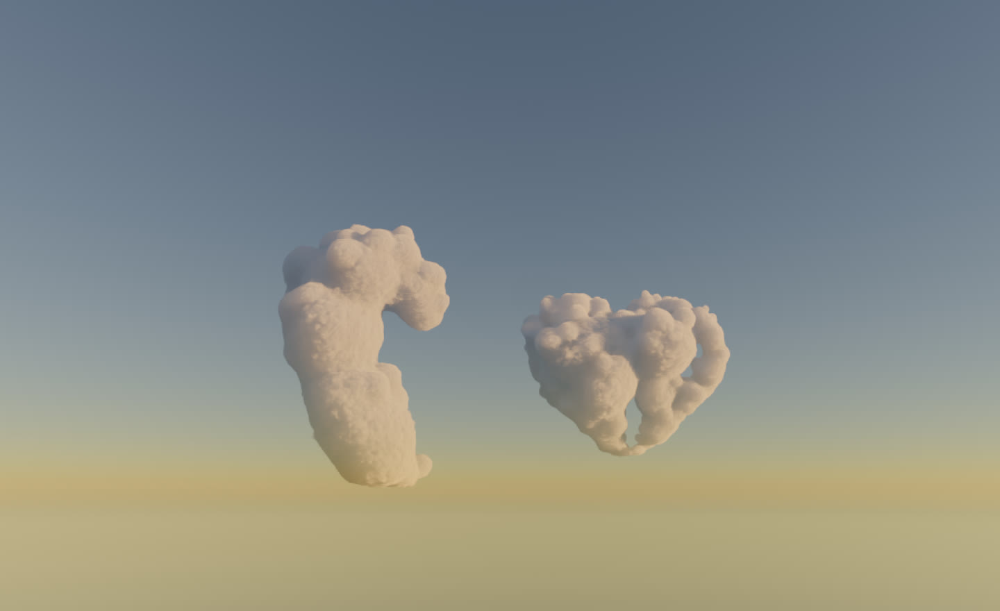
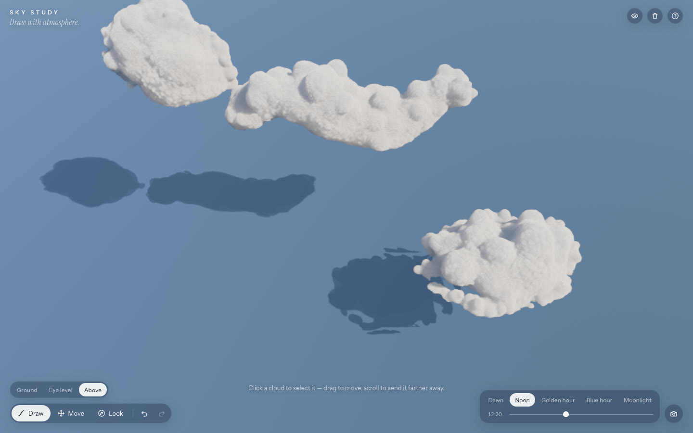
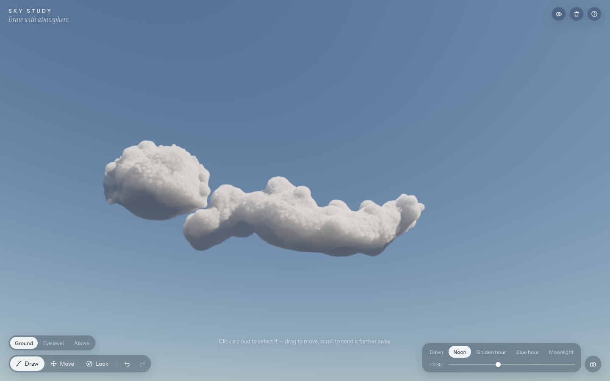
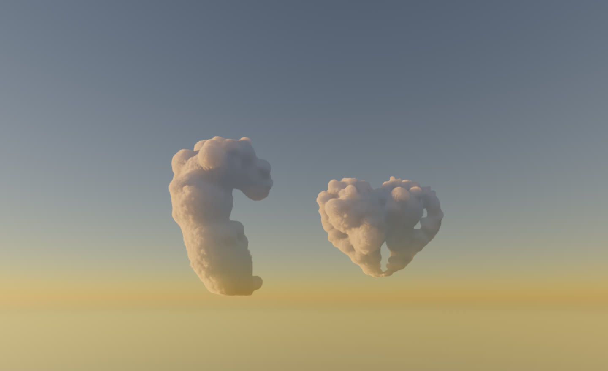
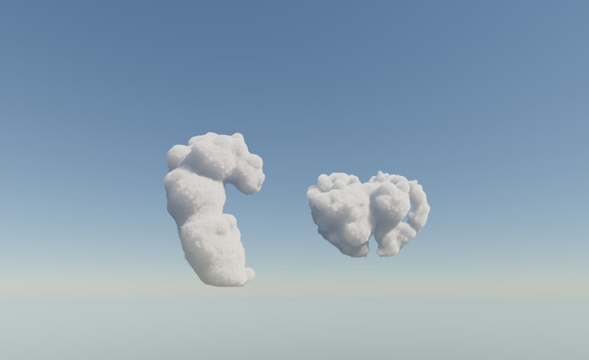
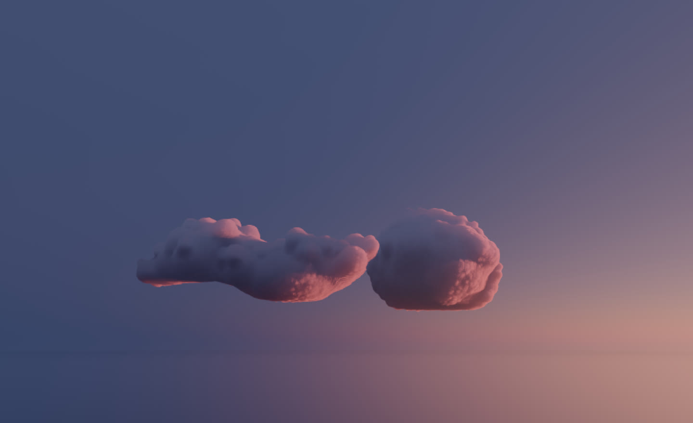
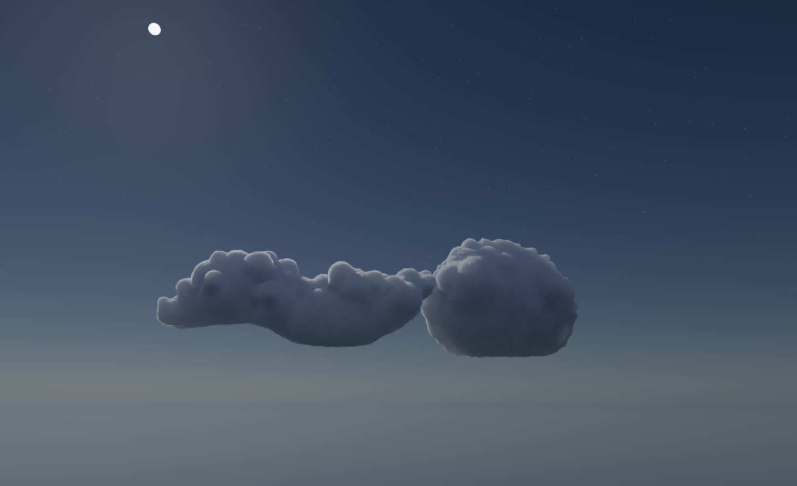
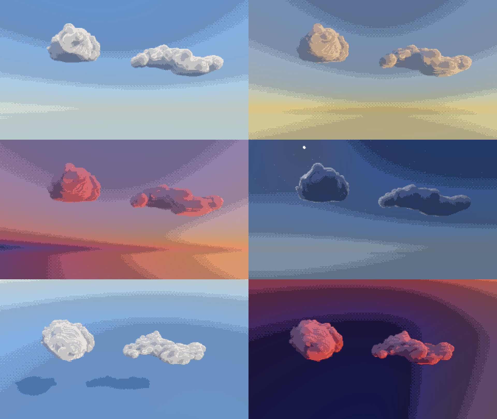

# SKY STUDY — draw with atmosphere

Draw a line in the sky and it gathers into a cloud: a real volume, raymarched and lit by the same physically based atmosphere that paints the sky. Select clouds, drag them, push them kilometres into the distance, resize them, fly freely among and above them, and move the light from dawn to moonlight.



| Above | Ground |
| --- | --- |
|  |  |

| Dawn | Noon | Blue hour | Moonlight |
| --- | --- | --- | --- |
|  |  |  |  |

**Pixel-art style** (`P`): the same 3D clouds and lighting, finished like hand-made pixel art.



A 30-second showcase recorded from the app itself (UI hidden): [docs/showcase.mp4](docs/showcase.mp4). How it works: [CASE_STUDY.md](CASE_STUDY.md).

## Run

```bash
npm install
npm run dev          # http://localhost:5362
```

Needs WebGL2 with float render targets (any recent desktop Chrome, Edge, Safari or Firefox on hardware graphics). If WebGL2 is missing the app says so instead of rendering a blank page.

## Use

| Input | Action |
| --- | --- |
| Drag on the sky | Draw a cloud (open strokes stretch along the gesture; closed loops fill and puff up). Looking down from high up, a stroke draws the cloud's footprint. |
| Click a cloud | Select it — drag to move, drag a corner to resize |
| Scroll / ⇧-drag on a cloud | Push it farther away or pull it closer |
| `B` / `V` / `L` | Draw / move / look tool |
| `W A S D` or arrows | Fly anywhere (hold ⇧ to go faster); `Q` / `E` sink / rise |
| Scroll on empty sky | Glide forward or back along your view |
| Right-drag, Look tool, or ⇧+arrows | Look around (turn and tilt) |
| `R` / Reset view | Back to the starting viewpoint |
| Touch screens | An on-screen move pad flies the camera |
| `1`–`5` | Dawn · Noon · Golden hour · Blue hour · Moonlight |
| ⌘Z / ⇧⌘Z | Undo / redo (a whole drag is one step) |
| `⌫` | Delete the selected cloud |
| `P` / pixel button | Pixel-art style (pixel size in the help panel) |
| `H` | Hide the interface |
| Camera button | Save PNG (screen size or 2×), record a clip, play or record the showcase |

The sky and the viewpoint are saved in the browser and restored exactly on reload; scenes can be exported and imported as JSON (help panel).

## Scripts

```bash
npm run typecheck    # tsc
npm run lint         # eslint
npm test             # Vitest unit tests
npm run test:e2e     # Playwright (Chromium on Metal; @cross tests also on WebKit)
E2E_PROD=1 npm run test:e2e   # same suite against the production build
npm run build        # production bundle in dist/
```

Development tools:

- `/spike.html?preset=golden&shapes=wave,heart&quality=high` — deterministic render harness.
- `node scripts/shoot.mjs name "query"` — headless GPU screenshots of the harness into `artifacts/`.
- `node scripts/bench.mjs` — GPU timing (gl-synchronised) for 1/4/8/16 clouds at each quality level.
- `node scripts/record-showcase.mjs` — records the in-app showcase and builds a contact sheet.

## Deploy

It's a static Vite app: `npm run build` and serve `dist/` from any static host (for example `npx vercel deploy --prod` from the repo root). It isn't deployed anywhere yet.

## Layout

```
src/atmosphere   sky physics (CPU mirror) and the time-of-day model
src/clouds       gesture → lobes → baked coverage volume
src/renderer     WebGL2 renderer and GLSL (sky LUT, noise, raymarch, accumulate, present)
src/engine       render loop, quality adaptation, showcase script
src/interactions drawing plane, picking, strokes
src/state        scene document, undo/redo store, persistence
src/capture      PNG capture and MediaRecorder recording
src/ui           React interface
tests/unit       Vitest      tests/e2e   Playwright
```

Inspiration and attribution: [ATTRIBUTION.md](ATTRIBUTION.md).
